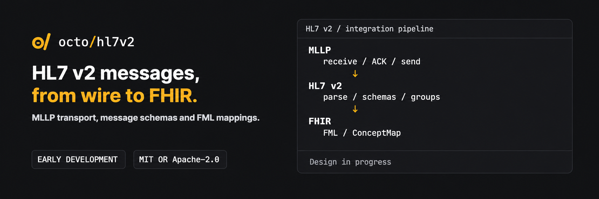

<p align="center"></p>

<p align="center"><b>HL7 v2 tooling in Rust: independent ER7 parsing, message schemas, MLLP and ACKs.</b></p>

<p align="center">
  
  <a href="#license"></a>
</p>

> ER7 parsing/editing, MLLP/ACK, caller-supplied schema grouping and field checks, optional async receiver and PostgreSQL custody are implemented. Versioned standards catalogs, FHIR maps and clinical processing are planned.

## Available now

The `octofhir-hl7v2` Rust package provides an original ER7 parser and editor. Its default library
has no third-party dependencies. It retains exact source bytes, byte spans, field positions, repetitions and unknown/Z-segments,
and distinguishes missing, empty, explicit null and populated positions. Scalar escape decoding is
explicit; unsupported escapes remain inspectable. [Numeric/date views](docs/scalars.md) validate explicit
decimal, DT, DTM and TS reads while preserving signs, zeros, partial precision and offset presence.
Decimal views also provide exact numeric comparison, zero checks and precision/scale queries
without changing their lexical bytes.
Parser and editor limits bound input, index and output growth.
Sparse [editing](docs/editing.md) can explicitly create missing positions within existing segments,
preserving coordinates by filling intervening siblings with empty values. Segment builders use the
same escaping and sparse positions; an editor can insert new non-MSH segments and remove original
segments in the same revision while retaining untouched bytes. `Message::create` starts a fresh
message from explicit delimiters without a template or invented header values.

The initial supported subset uses distinct ASCII punctuation delimiters, four or five MSH-2 encoding
characters and CR segment terminators; CRLF/LF require an explicit compatibility option. Parsing
accepts non-UTF-8 bytes but does not transcode character sets or validate an HL7 schema/version.
See the [wire API and limitations](docs/wire.md).

The dependency-free [schema engine](docs/schema.md) compiles caller-supplied sequence/group rules,
resolves exact release and event/structure bindings, and exposes nested/repeated group views over
original segment occurrences. Ambiguous grammars and unsupported envelope/profile variants fail
explicitly. Separate [field profiles](docs/validation.md) check presence, cardinality, explicit length
units and datatype lexemes, including OBX-5 types selected by the same OBX's OBX-2. Checks retain
source coordinates and have work/byte/report budgets. Closed caller-defined UTF-8 code sets support
exact membership checks in fields/components and dynamic selectors. Same-segment presence/equality
predicates can require or forbid optional fields. Approved versioned catalogs,
standards import/overlays, broader conditional rules and external terminology validation remain planned.

The optional `schema-package` feature wraps native definitions in an immutable
[schema package](docs/schema-packages.md) with required source/scope/limitations metadata and a
deterministic SHA-256. Bounded native binary export/loading restores an owned compiled package
against an exact expected digest. Legacy definitions retain V1 digest/export bytes; code sets use V2
and conditional presence uses V3.
The host retains historical files and includes the schema digest
in its processing plan. Official standards-artifact import and asset storage remain planned.

The optional [`hl7v2-validate` command](docs/offline-validation.md) loads a package against an
expected schema digest and checks local ER7 files with bounded structure/field reports and source
coordinates. It reuses one activated package and prints no field values.

The [MLLP codec](docs/mllp.md) handles fragmented/coalesced frames, an explicit payload limit,
incomplete EOF and framing errors. It returns one borrowed payload at a time and retains no output
queue. Encoding supports a framed buffer or a standard writer.

[ACK generation and correlation](docs/ack.md) support a documented v2.5.1 envelope subset, original
mode and enhanced acknowledgement conditions. The optional `transport` feature adds Tokio-backed
[async connections](docs/transport.md): persistent sessions, bounded frames, deadlines and one
outstanding request with MSA-2 correlation. `serve` adds a bounded TCP receiver with sequential
handlers, per-handler deadlines and graceful shutdown. The host supplies the bound listener,
processing and ACK timing. Standalone connections never generate a success ACK automatically.

The optional `postgres` feature adds an initial [durable custody inbox](docs/inbox.md) on a
host-provided SQLx pool. It stores exact payloads, pinned plan identities and ACK bytes atomically,
deduplicates scoped deliveries and retains conflicting payloads. Its supported contract is v2.5.1
enhanced `AL/NE`; it returns `CA` after commit. [Work-state APIs](docs/work.md) add durable claims,
leases, attempt history, retry scheduling and quarantine. The host owns the execution loop and
clinical application; there is no FML/FHIR processor yet. Database schema setup and interface admission are host policy.
An audited [quarantine replay](docs/replay.md) can grant another bounded run with the same pinned
plan while preserving generations, prior attempts, original bytes and custody ACKs.

```rust
use octofhir_hl7v2::wire::{Message, Presence};

fn main() -> Result<(), Box<dyn std::error::Error>> {
    let input = b"MSH|^~\\&|LAB\rPID|1||p1||Example^Alex|\r";
    let message = Message::parse(input)?;
    let pid = message.segment_named(b"PID", 1).ok_or("PID segment is missing")?;
    assert_eq!(pid.field(6).presence(), Presence::Empty);
    assert_eq!(pid.field(7).presence(), Presence::Missing);
    assert_eq!(pid.field(5).child(1).child(2).decode()?.as_ref(), b"Alex");
    Ok(())
}
```

From this checkout, with Rust 1.98 or newer:

```sh
cargo test --locked --offline
cargo test --locked --offline --all-features
cargo run --offline --example inspect -- tests/fixtures/adt.er7
cargo bench --offline --bench wire
cargo bench --offline --bench schema
```

The package has not been published to crates.io. The wire benchmark separates local parser/index,
lexical, prepared-edit serialization and complete edit/reindex timings. The schema benchmark
separates grouping, field checks and complete parse/group/check timings over synthetic profiles.
Neither includes transport, durability, terminology or FHIR processing.
Tokio, SQLx and SHA-256 are optional library infrastructure; `schema-package` enables SHA-256
without enabling transport or PostgreSQL. Development tests also use Tokio.
No third-party HL7 implementation is used. PostgreSQL tests require an explicitly configured
dedicated database and are listed as ignored by the normal test command; see the inbox guide.

[Coverage-guided fuzzing](fuzz/README.md) runs separately with pinned nightly tooling and synthetic
seeds. It checks ER7 spans/edits/ACKs, MLLP chunking/limits, schema compilation/grouping and field checks
without adding runtime dependencies.

## Direction

Build an HL7 v2 library that works independently of a FHIR server, with optional FHIR conversion
and a runtime that can be embedded in [OctoFHIR](https://github.com/octofhir/server-rs) or deployed
as a separate gateway.

| Layer | Planned scope |
|---|---|
| Message core | ER7 parsing and serialization; preserve field positions, repetitions, custom delimiters, unknown segments and original bytes |
| Schemas | Versioned message, segment and datatype definitions; nested groups and per-interface overrides |
| MLLP | Async receiver and sender; persistent connections, bounded frames, timeouts, backpressure and correlated HL7 acknowledgements |
| FHIR conversion | FML maps on [fml-rs](https://github.com/octofhir/fml-rs), ConceptMaps, validation and reports of unmapped or lost data |
| Processing | Durable inbox, delivery deduplication, entity identity, event ordering, retries, quarantine and replay |

Initial mapping candidates are ADT A01/A03/A08 and ORU R01 to FHIR R4. Their exact scope will be
defined against a representative message corpus.

## Design principles

- Parse the wire format independently of the schema; apply schema-aware views and validation on top.
- Keep transport and the message core independent of FHIR.
- Use FML and ConceptMap for FHIR mappings.
- Keep conversion separate from applying an event to existing clinical data.
- Distinguish message identity from patient, encounter, order and result identity.
- Define acknowledgement semantics per interface, including the boundary between durable receipt
  and successful application processing.
- Measure performance with the validation and durability guarantees stated explicitly.

The [HL7 V2 to FHIR Implementation Guide](https://hl7.org/fhir/uv/v2mappings/) is a mapping reference.
Its ConceptMaps are not a ready-to-run set of FML transforms.

The [architecture](docs/architecture.md) and [implementation plan](docs/implementation-plan.md)
record accepted decisions, integration boundaries and remaining verification gates.

## Related projects

- [OctoFHIR server](https://github.com/octofhir/server-rs)
- [fml-rs](https://github.com/octofhir/fml-rs) — FHIR Mapping Language parser, checker and engine
- [ccda-fhir](https://github.com/octofhir/ccda-fhir) — C-CDA and FHIR conversion on FML maps

## License

Licensed under either [MIT](LICENSE-MIT) or [Apache-2.0](LICENSE-APACHE), at your option.
