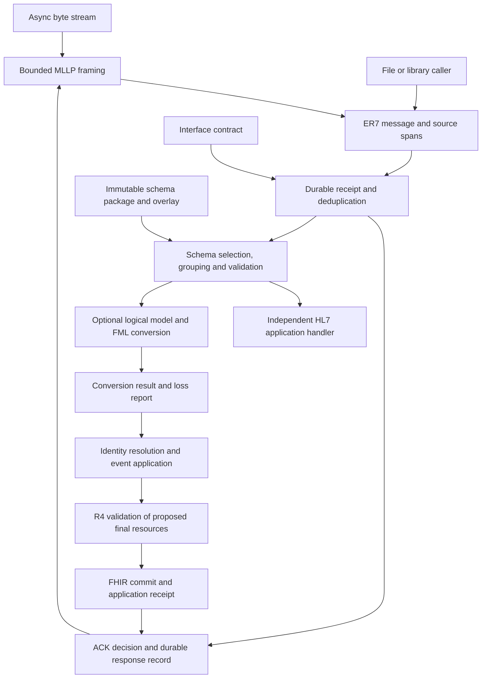

# HL7 v2 architecture

Status: architectural baseline, 2026-11-10. Implementation has been authorized and the initial wire layer is available; its actual API, supported subset and limitations are described in [wire implementation](wire.md). The broader components below remain a design unless explicitly marked implemented. The accompanying [implementation plan](implementation-plan.md) tracks progress and acceptance gates.

The toolkit owns the path from HL7 v2 bytes to a durable processing outcome. Its message core, schemas, MLLP transport and receipt processing remain usable without FHIR. Optional FHIR conversion uses OctoFHIR FML and ConceptMap; a separate application layer reconciles converted events with existing clinical data.

## Decisions and scope

The following decisions form the accepted design direction. Concrete Rust type names, feature names and storage APIs remain proposals until implementation.

| Decision | Consequence |
|---|---|
| D1. Parse ER7 independently of schemas | Unknown versions, fields and Z-segments can still be retained and inspected. Schema failure does not destroy a parsed message. |
| D2. Original bytes and positional state are authoritative | Decoded strings, schema views and FML inputs are projections, never replacements for the original. |
| D3. Resolve an exact schema package and interface overlay | MSH-12, MSH-9.3 and a versioned event-to-structure table participate in selection. No nearest-version fallback. |
| D4. Implement MLLP and HL7 ACK as separate layers | Framing has no clinical or durability semantics; the processing policy determines ACK timing. |
| D5. Persist before acknowledging durable acceptance | A socket write or an in-memory queue is not a receipt boundary. Original and enhanced modes have distinct contracts. |
| D6. Use FML/StructureMap and ConceptMap | No Jinja, Liquid or additional mapping language. Conversion does not implicitly mutate the FHIR repository. |
| D7. Separate delivery, message and clinical identity | A duplicate delivery cannot create a second clinical effect; two events about one patient are not duplicates. |
| D8. Pin the processing environment | Replay records exact schemas, overlays, maps, terminology, validation and application policy. |
| D9. Keep packaging small | Begin with one library package, optional modules/features and an optional CLI/gateway binary. Split crates only for a demonstrated dependency or deployment need. |
| D10. Verify correctness before performance claims | Compare equivalent validation, ACK boundaries and durability. Report ACK and FHIR commit latency separately. |
| D11. Implement the HL7 protocol stack in this project | Write the ER7 parser/writer, schema layer, MLLP framing and ACK logic as original OctoFHIR code under MIT OR Apache-2.0. Do not adopt, vendor or copy another HL7 implementation. |

The first target is a deliberately narrow HL7 v2.5.1 ADT A01 interface producing FHIR R4 Patient and Encounter changes. A03, A08 and ORU R01 follow after the first scenario passes recovery tests. This is a proposed initial support profile, not a claim of general v2.5.1 or ADT conformance.

Batch envelopes, DSC/ADD continuation, sequence-number protocol, arbitrary event families, outbound clinical message generation and TLS/mTLS policy are outside the first scenario. Preserve their observable wire content; do not silently process an unsupported protocol as an ordinary message.

### Implementation ownership

The decision after reviewing existing candidates is to implement our own HL7 stack. Independent operation does not technically require an original parser, but original implementation is now an explicit project requirement. Existing projects serve as comparison material and sources of questions to check against the standard; their code, tests and bundled schema catalogs will not be copied into this repository. Author our own protocol fixtures and version-specific definitions with recorded reference evidence.

This decision concerns HL7 implementations, including `hl7-rust`, its separate `er7` dependency, and EffortlessMetrics/hl7v2-rs. General-purpose dependencies such as Tokio and the existing OctoFHIR FML/FHIR libraries remain separately selected dependencies. Original protocol code does not establish the terms or accuracy of standards data: schema and mapping artifacts still need explicit provenance and applicable terms.

### Targeted review of existing Rust implementations

The following source review informed the ownership decision. It does not claim a complete audit, executed upstream tests or measured performance.

| Project and inspected revision | Useful implemented surface | Relevant differences from this architecture |
|---|---|---|
| `hl7-rust/hl7-rust` `18979c0f5dbf65a65edeca08b420b65de73a9649` | `hl7-2` layers dictionaries and generic/schema/struct views over the separate `er7` crate; dynamic OBX typing, nested structures, an XSD dictionary converter, MLLP framer and ACK builder exist. | `hl7-2::parse` normalizes line endings, trims each line and drops blank lines before parsing. Version selection uses `Version::nearest` and a default. Bundled v2.5.1 inherits v2.5, while the provenance document explicitly records missing source evidence for the authored tables. MLLP `IoTransport` uses synchronous `Read + Write`. These APIs cannot be adopted unchanged for exact wire retention, strict release selection and our async runtime. |
| `EffortlessMetrics/hl7v2-rs` `c1bbfc8a0a5890ae2c53a8294353a346ec7e78ab` | Generic message hierarchy, four-state `Presence`, escape handling, profiles, ACK helpers and Tokio MLLP client/server/codec exist. | The workspace declares AGPL-3.0-or-later; the user's exclusion remains in force. The normal parser requires UTF-8 and returns owned decoded atoms, without the original payload/spans in `Message`. `MllpClient::send_message` parses and returns the next frame without checking MSA-2 against the request. A wrapper would still need our preservation, correlation and durability contracts. |

Source evidence for hl7-rust: [parser and raw wrapper](https://github.com/hl7-rust/hl7-rust/blob/18979c0f5dbf65a65edeca08b420b65de73a9649/hl7-2/src/message.rs), [normalization](https://github.com/hl7-rust/hl7-rust/blob/18979c0f5dbf65a65edeca08b420b65de73a9649/hl7-2/src/lib.rs), [version resolution](https://github.com/hl7-rust/hl7-rust/blob/18979c0f5dbf65a65edeca08b420b65de73a9649/hl7-2/src/version.rs), [v2.5.1 dictionary](https://github.com/hl7-rust/hl7-rust/blob/18979c0f5dbf65a65edeca08b420b65de73a9649/hl7-2/schemas/v2.5.1.json), [schema provenance](https://github.com/hl7-rust/hl7-rust/blob/18979c0f5dbf65a65edeca08b420b65de73a9649/spec/schema-data-provenance/index.md), [synchronous transport](https://github.com/hl7-rust/hl7-rust/blob/18979c0f5dbf65a65edeca08b420b65de73a9649/hl7-2-mllp/src/transport.rs). The package's [license expression](https://github.com/hl7-rust/hl7-rust/blob/18979c0f5dbf65a65edeca08b420b65de73a9649/hl7-2/Cargo.toml) includes MIT and Apache-2.0 as alternatives; the ownership decision is a project preference, not a claim that permissive use is unavailable.

Source evidence for EffortlessMetrics: [manifest and license declaration](https://github.com/EffortlessMetrics/hl7v2-rs/blob/c1bbfc8a0a5890ae2c53a8294353a346ec7e78ab/Cargo.toml), [message parser](https://github.com/EffortlessMetrics/hl7v2-rs/blob/c1bbfc8a0a5890ae2c53a8294353a346ec7e78ab/crates/hl7v2/src/parser/message.rs), [message model](https://github.com/EffortlessMetrics/hl7v2-rs/blob/c1bbfc8a0a5890ae2c53a8294353a346ec7e78ab/crates/hl7v2/src/model/mod.rs), [MLLP client](https://github.com/EffortlessMetrics/hl7v2-rs/blob/c1bbfc8a0a5890ae2c53a8294353a346ec7e78ab/crates/hl7v2/src/transport/network/client.rs).

Recent main-branch history showed maintenance commits on 2026-10-16 for hl7-rust and protocol fixes on 2026-09-06 for EffortlessMetrics. This establishes recent activity, not production adoption or a multi-maintainer support guarantee. [hl7-rust maintenance commit](https://github.com/hl7-rust/hl7-rust/commit/97bc41577111065f96b5397363f55b5259f4fa84), [EffortlessMetrics writer fix](https://github.com/EffortlessMetrics/hl7v2-rs/commit/c1bbfc8a0a5890ae2c53a8294353a346ec7e78ab).

## Component boundaries

Envelope checks needed for acceptance occur before the durable acceptance decision. Full schema and application checks can occur in the worker, according to the interface contract. In original mode the ACK waits for the configured application completion boundary.

| Module | Owns | Must not require |
|---|---|---|
| `wire` | Bytes, delimiter discovery, positional index, escape tokens, serialization, wire diagnostics | Schema catalog, Tokio, FHIR, database |
| `schema` | Package resolution, group views, datatype interpretation, v2 validation, overlays | FHIR resources or FML execution |
| `mllp` | Async frame codec, receiver/sender sessions, bounds and connection lifecycle | Database or FHIR |
| `ack` | Header interpretation, ACK construction/parsing, choreography and correlation | A particular storage backend |
| `processing` | Receipt state, attempts, deduplication, retry, quarantine and replay contracts | FHIR-specific entity rules |
| `fhir` | Logical models, FML assets and execution, ConceptMaps, conversion diagnostics | A running OctoFHIR server |
| `application` | Clinical identity, event reconciliation, ownership and commit receipt contracts | A particular HTTP server |
| Host adapter | Storage, credentials, validation services, FHIR write path, metrics and operator access | Changes to wire semantics |

Dependency direction is toward `wire`. FML and PostgreSQL dependencies are optional. In-memory processing is useful for codec tests and explicit ephemeral use; it must never advertise durable acceptance. A gateway and an embedded server use the same message and processing contracts. Neither embedding nor conversion requires a network round trip through `$transform`.

## Message representation and wire semantics

### Storage and coordinates

Use one immutable owned byte buffer per message, with inexpensive shared ownership, and an index of byte ranges. An illustrative ownership choice is an `Arc<[u8]>` plus integer offsets; it avoids a self-referential Rust object. Do not require valid UTF-8 to parse delimiters and positions. Framing bytes are separate from the ER7 payload; optional transport evidence records them without making them part of message identity.

The index preserves ordered segment occurrences, field positions, repetitions, components and subcomponents, including empty slots and trailing delimiters. Unknown fields and segments have the same positional access as known ones. Segment occurrences have stable IDs independent of their three-character names; a map keyed only by `PID` or `OBX` would lose ordering and duplicates.

Public HL7 positions use one-based field/component/repetition numbering. Internal arrays may be zero-based, but diagnostics must label that distinction. Each diagnostic carries the message ID, byte range `[start, end)`, segment occurrence, wire path such as `OBX[3]-5[2].1`, stage, code and severity. Schema group paths are additional coordinates. Missing positions have an expected location, not an invented byte span; present empty positions can have a zero-length span. Line/column rendering is derived from the original segment boundaries and is never substituted for byte offsets.

Decoded text may span several escape tokens or multibyte characters. Keep its relationship to original ranges; a character offset in decoded text is not a wire byte offset. Diagnostics and operator screens should avoid exposing full payloads by default.

### Presence is data

Retain a four-state value model at every applicable positional level:

| State | Wire example | Meaning available to higher layers |
|---|---|---|
| Missing | `PID\|1\|\|A` queried at PID-4 | That position was not transmitted. |
| Empty | PID-2 in `PID\|1\|\|A`, or a final `\|` | A transmitted slot with zero bytes. |
| Explicit null | A slot containing exactly `""` | An explicit null token; its permitted location is validated separately. |
| Value | Any nonempty scalar/composite/repetition content | Keep lexical bytes and structure before typed interpretation. |

`A~~B`, `A~B`, an omitted field and a trailing empty repetition are different. Literal quotes inside other text do not become a null token. Mixed or misplaced null tokens remain inspectable and receive datatype/profile diagnostics. Do not collapse these states into `Option<String>`, JSON `null`, or one empty FHIRPath collection.

The application contract decides whether an empty or null source field means no change, clear, replace or reject. Those rules can differ by field and sender. Presence alone never authorizes deleting a FHIR element.

### Delimiters, escaping and character sets

Bootstrap from the first MSH header: MSH-1 is the field separator byte, and MSH-2 declares the encoding characters. MSH-1 and MSH-2 require special indexing; splitting a whole message on `|` cannot implement this correctly. Detect invalid, repeated or conflicting separator characters. Preserve an optional truncation character declaration and truncation tokens; interpreting them requires the selected version/profile.

Index the wire structure before decoding scalar escapes. Decode `F/S/R/T/E` using the message's declared separators, with one pass so a decoded escape character is not reinterpreted. Hex escapes produce scalar content; a decoded CR must not create a segment. Formatting, highlighting, local `Z` escapes and character-set switching are tokenized and preserved, even when semantic decoding is unsupported. Unterminated or malformed escapes produce diagnostics without silently discarding bytes. Never use a chain of string replacements as the escape implementation.

CR is the standard segment terminator. CRLF/LF acceptance is an explicit interface compatibility option with a diagnostic, retained terminator spelling and a pinned configuration revision. Do not trim spaces, normalize line endings or remove a final terminator in the stored original or delivery digest.

Separate structural parsing from character decoding. MSH-18 and related character-set declarations, plus a configured default, select a decoder. Start with a documented ASCII/UTF-8 subset; preserve unsupported encodings and fail text-dependent processing explicitly. Never replace undecodable bytes with U+FFFD and then claim lossless conversion. A byte scanner does not by itself support every multibyte HL7 character set.

### Typed values and serialization

Numbers retain their lexeme, sign, scale and exponent spelling where allowed. Typed numeric operations use an exact decimal/integer representation, never an obligatory `f64` conversion. DT/DTM/TS values retain precision, fractional seconds, offset presence and any declared degree of precision. A year or month is not an invented complete date; a local timestamp without an offset is not automatically UTC. Invalid lexemes remain available with errors.

Expose separate operations:

1. **Original emission:** return the stored payload unchanged, including unsupported tokens and compatible nonstandard terminators.
2. **Edited serialization:** retain untouched ranges; serialize changed values with the declared separators and datatype-aware encoding. Generated text is escaped exactly once. If delimiters or encoding change, re-encode the affected message under an explicit operation and report unrepresentable content.
3. **Canonical emission:** an explicitly requested normalization, with documented policies. It is unsuitable for delivery hashing or proof of byte equivalence.

The editor needs explicit unset/empty/null/value operations. Retain the immutable original and the revision relationship after edits. Do not promise lossless regeneration from a schema view or FHIR output.

## Versioned schemas

### Source investigation and selection

The catalog in atomic is credited to Redox. At the inspected commits both repositories have one shared hierarchy of messages, segments, fields, datatypes and event-to-structure mappings, rather than release-indexed catalogs. Redox's `OBX.5` says `varies`; its build script generates JavaScript indexes, not per-version definitions. These illustrate catalog organization and comparison cases, but they do not establish the HL7 release or conformance completeness of each definition. They are not selected for import under D11. See the pinned [Redox catalog](https://github.com/RedoxEngine/redox-hl7-v2/tree/1a4bccfb7ff45627a7398bbe864c1012b371fa6d/schema), [index generator](https://github.com/RedoxEngine/redox-hl7-v2/blob/1a4bccfb7ff45627a7398bbe864c1012b371fa6d/build-schema.js), [dynamic OBX field](https://github.com/RedoxEngine/redox-hl7-v2/blob/1a4bccfb7ff45627a7398bbe864c1012b371fa6d/schema/fields/OBX.5.json) and [atomic credits](https://github.com/atomic-ehr/atomic-hl7v2/blob/9917780613421dd766056f7a04ba2b8cd6f3add3/README.md#credits).

Redox carries Apache-2.0 and atomic carries MIT at those revisions. Importing through atomic does not remove the need to track original data provenance and applicable notices. The project code remains MIT OR Apache-2.0; third-party data must retain its own attribution and terms. This design does not establish redistribution rights for an upstream standards database. [Redox license](https://github.com/RedoxEngine/redox-hl7-v2/blob/1a4bccfb7ff45627a7398bbe864c1012b371fa6d/LICENSE), [atomic license](https://github.com/atomic-ehr/atomic-hl7v2/blob/9917780613421dd766056f7a04ba2b8cd6f3add3/LICENSE).

Preferred candidate for the first version-specific structural baseline: the official HL7 v2.5.1 XML schema distribution. HL7 publishes it as a convenience representation rather than a normative schema specification; XML validation is not ER7 validation. The product page was accessible through HL7's alternate host, but the download redirected to login, so archive contents, checksums and terms have not been verified. Treat acquisition and validation of that exact archive as a release gate, not as a completed dependency decision. [HL7 v2.5.1 schema product](https://dev3.hl7.org/implement/standards/product_brief.cfm?product_id=218).

| Candidate | Intended use | Remaining condition |
|---|---|---|
| Official release-specific HL7 XML schema archive and corresponding standard | Structural import candidate for each supported release | Obtain exact artifact and terms; audit field/group coverage and ER7-specific gaps. |
| Redox/atomic flat catalog | Structural comparison only; not selected for import | Do not copy the catalog or relabel it as v2.5.1. Establish our own source-checked definitions. |
| HAPI version-specific generated structures | Independent structural cross-check or differential test tool | Do not copy generated Java into this library. Its build uses an HL7 database, and code/data terms need separate assessment. |
| Explicit local interface profile | Narrow, reviewed support for a sender | Declare its exact scope, provenance and deviations; it cannot stand in for general version coverage. |

HAPI's own build documentation describes generation from an HL7 database; this is evidence of a versioned comparison source, not an immediately reproducible freely distributable source database. [HAPI build documentation](https://hapifhir.github.io/hapi-hl7v2/building.html).

No production schema supplier is approved by this document. The decision is to own a stable schema representation and require evidenced versioned packages, authored and reviewed against the standard or generated by our importer from an explicitly approved standards artifact. Do not bootstrap these packages by copying another library's bundled tables. Wire and transport work can proceed while schema acquisition is resolved. A synthetic interface profile can exercise the pipeline, but cannot pass a release's schema conformance gate.

### Package format and import contract

An immutable package contains:

- HL7 release ID, schema format version and package revision, all distinct;
- source URL/revision, artifact digest, attribution/terms, importer version and output digest;
- ordered segment fields and datatype components, lexical constraints and code bindings;
- message grammar with nested groups, choices, occurrence constraints and stable group IDs;
- a release-specific `(message code, trigger event) -> structure` table;
- dynamic datatype rules, including OBX-5 selected by the same OBX's OBX-2;
- an explicit completeness matrix: imported, manually reviewed, unsupported or unknown constraints.

The importer resolves all references, rejects invalid cardinalities and unexpected cycles, and emits deterministic artifacts. It reports unrepresentable constructs instead of dropping them. XSDs may supply structure, but ER7 null semantics, conditional requirements, dynamic typing, vocabulary and event associations need additional reviewed sources. Generated logical StructureDefinitions are a downstream projection, not the schema system's FHIR-dependent foundation.

An overlay identifies its exact base digest, interface and revision. Use explicit edits to named fields/groups or whole ordered lists; avoid an implicit deep merge of arrays. Record each deviation and compile a new effective schema digest. Validate overlays for broken references, ambiguous groups and inconsistent datatype overrides before activation. Activate configuration atomically for new receipts; existing attempts keep their pinned package.

### Selection and grouping

Selection is deterministic:

1. Resolve the configured interface and allowed processing environment independently of sender claims in MSH.
2. Read MSH-12.1 and preserve the rest of the version identifier. Require an exact supported release, or an explicit, audited interface override for an absent/incorrect declaration.
3. If MSH-9.3 is populated, select that structure in the release package. Check compatibility with MSH-9.1/9.2 and the interface profile. An unknown or contradictory structure is an error, not permission to ignore MSH-9.3.
4. If MSH-9.3 is absent, use the release-specific event table. Do not synthesize `message_event`: for example, Redox's inspected table associates ADT A08 with ADT_A01, illustrating why concatenation is insufficient. Verify the association for the actual supported release. [Inspected event table](https://github.com/RedoxEngine/redox-hl7-v2/blob/1a4bccfb7ff45627a7398bbe864c1012b371fa6d/schema/structure/index.json).
5. Apply the pinned overlay and any explicitly registered profile selection, including MSH-21 where the interface uses it. An unsupported profile identifier cannot silently change the grammar.

Grouping is a view over segment occurrence IDs and ranges, not a rewritten message. Compile the grammar and bound lookahead/work. Repeated segment names in different groups remain distinct; missing optional groups do not shift later observations into the wrong order. Unknown and Z-segments stay in the sequence and receive explicit extension attachments or an unassigned status. Ambiguous grouping must be reported; no heuristic reassignment may create clinical associations.

Validate envelope, group structure, cardinalities, datatype lexemes, conditional rules and code bindings as separately identifiable checks. A lenient inspection view may survive errors; a clinical conversion needs an unambiguous supported view. An absent or unsupported OBX-2 leaves OBX-5 raw and produces a diagnostic rather than guessing ST or NM. Repetition, null and empty states survive datatype interpretation.

## FML and FHIR integration

### Verified neighboring APIs

These are source observations from local checkouts, not guarantees about every published crate version.

| Checkout and revision | Verified integration surface | Architectural implication |
|---|---|---|
| `fml-rs` `574ebbb182316be5b10ece234d2c37ae1428f9a9` | `fml_model::compile`; `fml_check::check`; `Definitions::structure` and `covers`; `CoreDefinitions`; `PackageDefinitions::add` | Reuse compiler/checker and register HL7 logical structures alongside R4 definitions. |
| Same FML checkout | Logical snapshots preserve polymorphic elements without `[x]`; JSON `@type` selects the concrete logical type | Suitable starting point for dynamic OBX values; requires explicit model/instance tests. |
| Same FML checkout | `Engine::transform(&StructureMap, &Value)` / `transform_into`; internal private `Tree::load` | The current public entry point materializes JSON and loads another owned tree. There is no public borrowed HL7 source adapter. |
| Same FML checkout | `Expressions::evaluate` takes JSON-backed `Item`; `FhirPathExpressions` clones JSON into a typed FHIRPath collection | Changing only `Definitions` cannot remove runtime copies. FHIRPath and tracing must be included in the design. |
| `fhirpath-rs` `bbb45de60bd81e2b138f62e72a927591709709fb`; cached published 0.5.7/0.5.9 entry points also inspected | Public `FhirNode`, `Collection::from_json_node`, `FhirPathValue::resource_from_node` and `with_type_info` | Existing shared nodes are a candidate for expression interoperability; they do not provide a borrowed HL7 wire view or an FML source entry point. |
| Same FML checkout | `MapResolver`, `ConceptMapResolver`, `TranslateService`, `IdGenerator`, limits, cancellation, trace and warnings | Reuse extension points; enforce exact artifact resolution in a pinned wrapper. |
| `ccda-fhir` `d12f457f79c82184e728e8da27018cac91fa73f7` | Logical models + FML maps + ConceptMaps; one converter object reuses definitions and expressions | Useful converter composition pattern; its XML/JSON projection is not a lossless ER7 representation. |
| `server-rs` `26f5308d048041122f3b5eb7ecb2e2d78632e4bd` | FML runner, `ValidationService`, async jobs, `FhirStorage`/`Transaction`, DICOM sync | Reuse host services through adapters; several orchestration APIs are `pub(crate)` and are not external library contracts. |

Pinned source references: [FML definitions](https://github.com/octofhir/fml-rs/blob/574ebbb182316be5b10ece234d2c37ae1428f9a9/crates/fml-check/src/definitions.rs), [logical snapshots](https://github.com/octofhir/fml-rs/blob/574ebbb182316be5b10ece234d2c37ae1428f9a9/crates/fml-check/src/logical.rs), [engine](https://github.com/octofhir/fml-rs/blob/574ebbb182316be5b10ece234d2c37ae1428f9a9/crates/fml-engine/src/engine.rs), [tree](https://github.com/octofhir/fml-rs/blob/574ebbb182316be5b10ece234d2c37ae1428f9a9/crates/fml-engine/src/tree.rs), [expression interface](https://github.com/octofhir/fml-rs/blob/574ebbb182316be5b10ece234d2c37ae1428f9a9/crates/fml-engine/src/expressions.rs), [FHIRPath adapter](https://github.com/octofhir/fml-rs/blob/574ebbb182316be5b10ece234d2c37ae1428f9a9/crates/fml-engine/src/fhirpath.rs), [converter composition](https://github.com/octofhir/ccda-fhir/blob/d12f457f79c82184e728e8da27018cac91fa73f7/src/lib.rs).

There is version skew: the local FML workspace declares 0.2.5, while both consumer lockfiles resolve registry FML 0.2.6, with engine checksum `824bf8fd59e62e2dcbbaf0508c3a88daecc2cc31412b3c4b138f219ef8b805fb`. The cached 0.2.6 engine, tree, expression interface, FHIRPath adapter and ConceptMap resolver files were compared with the adjacent checkout and are identical. The JSON-boundary findings therefore also apply to that resolved engine. ccda-fhir resolves FHIRPath 0.5.7 and server resolves 0.5.9. Before implementation, select a coherent dependency set and compile a compatibility probe. No neighboring repository is modified by this design work.

### Logical source model

Define versioned logical message, group, segment and datatype models generated from the effective schema. Use stable machine names based on field/component positions, with human names as metadata; renaming a label must not break maps. Repeated items are collections. Each value-bearing slot exposes its presence state, lexical value, interpreted datatype and a stable source reference. Missing slots remain queryable through the presence contract rather than disappearing without explanation.

This is a model over the schema view, not a second clinical domain model. For example, an OBX observation-value slot has a state and a typed child selected by OBX-2. A numeric lexeme remains available even when a typed decimal is supported. An explicit-null slot remains a populated state node even though it has no clinical scalar value. Map conditions inspect this state when constructing clear/update intentions.

Maintain a side table from logical node/path to wire occurrence and ranges. The source reference is metadata and must not leak into FHIR resource fields. Treat unknown segments/fields as source elements eligible for loss reporting, even when the logical model has no typed navigation for them.

### Avoiding intermediate JSON copies

**Available now:** build one deterministic logical JSON projection and pass it directly as a `Value` to `Engine::transform`, without serializing it to text and reparsing. This uses existing APIs, but still allocates the projection, the internal FML tree and expression values. It is an honest compatibility baseline, not a zero-copy implementation.

**Preferred extension, requiring separate upstream work:** let FML load typed nodes directly from a read-only source visitor into its existing arena, carrying source references. This removes the whole source JSON object while retaining a familiar execution tree. A public loader/transform entry point is necessary; constructing today's private `Tree` externally is not supported. Scalar decoding may still allocate and the arena owns its nodes, so call this direct tree ingestion rather than zero-copy.

Reuse the existing FHIRPath `FhirNode` where practical instead of inventing a second shared JSON node type. Its containers and strings share storage, and `Collection::from_json_node` avoids first building a `Value`. It still represents an owned JSON-shaped tree, not a lazy byte-span provider. `resource_from_node` infers resource types from `resourceType`; HL7 logical fragments need explicit type metadata and a model provider, not a fabricated FHIR `resourceType`. FML would need a node-backed expression item/bridge to benefit: its current expression path calls `Tree::to_json` and clones the resulting `Value`, even though FHIRPath navigation itself shares nodes. [FHIRPath nodes](https://github.com/octofhir/fhirpath-rs/blob/bbb45de60bd81e2b138f62e72a927591709709fb/crates/octofhir-fhirpath/src/core/node.rs), [collection and value APIs](https://github.com/octofhir/fhirpath-rs/blob/bbb45de60bd81e2b138f62e72a927591709709fb/crates/octofhir-fhirpath/src/core/types.rs).

`FhirNode::Decimal` retains a decimal and source spelling within its supported numeric range. Its serializer preserves that spelling, whereas `to_json()` reparses a decimal into `serde_json::Value`; this boundary needs a precision probe under the actual unified serde features. Do not assume shared nodes make arbitrary-precision wire decimals safe through the entire FML target pipeline. Keep the source lexeme, reject unsupported arithmetic ranges, and prove exact target numeric emission or report a conversion failure.

**Further option, only if measurements justify it:** a read-only node-provider abstraction with stable handles, separate mutable target storage and typed scalar access. Source navigation could then read schema views lazily. It must cover copy semantics, collections, polymorphism, source immutability, cancellation and async lifetimes. It also needs a node-based expression interface or an explicit bounded materialization boundary; today's JSON-backed `Expressions::Item` would otherwise recreate the cost. Default tracing currently snapshots JSON values and needs a bounded alternative.

Do not fork FML or implement a second FML evaluator inside hl7v2. Prepare an upstream proposal and benchmark probe after implementation is authorized. The JSON baseline permits the first vertical scenario if the extension is not available; choose the adapter explicitly and record its cost. Shipping a direct-ingestion mode is gated on parity with the baseline for presence, exact numbers, partial dates, OBX typing, expressions and source diagnostics.

`Definitions` supplies type metadata, not runtime data access or full validation. The bundled `FhirPathExpressions` uses an embedded FHIR core provider; registering an HL7 logical model in `PackageDefinitions` alone does not establish FHIRPath type resolution or `conformsTo()` for that model. Probe navigation/type filters and, if needed, supply an `Expressions` implementation with a combined model provider. This remains an FML/FHIRPath integration change, not a new language.

### Maps, terminology and conversion result

Use the published [v2-to-FHIR IG 1.0.0](https://hl7.org/fhir/uv/v2mappings/) as a traceable R4 mapping reference. Its message/segment/datatype ConceptMaps and CSVs contain mapping guidance and conditions; they are not executable StructureMaps. Author and check FML assets for the supported interface profile, citing the corresponding IG artifact and recording deviations.

The converter returns proposed FHIR resources or a Bundle, event kind, identity evidence, explicit update/clear intentions, source provenance and a structured conversion report. FML owns clinical field transformations; schema adapters own wire/datatype interpretation; the application policy owns merging and persistence. Constructing a transaction request from converted resources is not permission to replace existing resources wholesale.

For each populated supported or unsupported source element, report whether it was mapped, intentionally ignored, unsupported, untranslatable, invalid or truncated, with wire coordinates and map/rule references where available. A debug trace is useful evidence but is not proof of complete source consumption. Use a reviewed mapping coverage manifest plus conversion instrumentation; do not infer coverage from fields read by conditions alone. Bound reports and expose when they are truncated.

Unknown codes retain system, code, sender scope and source location in the report. A required missing translation blocks application and creates a quarantine reason; optional lossy output requires an explicit interface policy. Operators can supply a sender-specific ConceptMap revision and request reprocessing. No tasks or messages are sent to external systems automatically.

Use immutable local ConceptMaps for deterministic replay, or record the external translation request/result and terminology snapshot. The inspected `ConceptMapSet::resolve` can fall back from `url|version` to `url`; exact replay therefore needs a resolver that rejects unavailable versions rather than silently choosing an unversioned resource. Imported StructureMaps and logical definitions require equally strict resolution. [FML ConceptMap resolver](https://github.com/octofhir/fml-rs/blob/574ebbb182316be5b10ece234d2c37ae1428f9a9/crates/fml-engine/src/terminology.rs).

### R4 validation

Pin FHIR R4 4.0.1 definitions and validator configuration. Validate the converted resources and the final proposed merged resources, plus Bundle structure and intra-Bundle references where applicable. The baseline includes cardinalities, types, required bindings supported by the terminology service and FHIRPath invariants for the base resource whether or not `meta.profile` is present. Add required interface profiles explicitly; unavailable required definitions or validation services are failures, not successful validation.

Use `ValidationService::validate` / `validate_with_known_refs` in the server adapter, or a standalone validator with equivalent R4 schemas and a FHIRPath engine. The inspected server service includes the base type and declared profiles; unresolved optional declared profiles may be warnings under server policy, so the interface must separately enforce required profiles. Structural deserialization and a successful FML type check do not constitute R4 validation. The ccda-fhir validator's Bundle/Composition exclusions are specific to that converter and must not be copied into this gateway. [Server validation](https://github.com/octofhir/server-rs/blob/26f5308d048041122f3b5eb7ecb2e2d78632e4bd/crates/octofhir-server/src/validation.rs), [C-CDA validation](https://github.com/octofhir/ccda-fhir/blob/d12f457f79c82184e728e8da27018cac91fa73f7/src/validation.rs).

## MLLP and acknowledgement contracts

### Framing and connection lifecycle

MLLP framing is `0x0B + payload + 0x1C 0x0D`. An incremental codec handles a split marker, a split trailer, one-byte reads and several frames in one read. A frame limit counts payload bytes, not TCP read length. Keep a bounded buffer and never wait for a terminator after exceeding the limit. A partial frame at EOF is incomplete, not a delivered message.

Configure limits for frame bytes, connections, buffered bytes per connection, global buffered bytes, queued messages/bytes, in-flight requests and ACK output. Configure connect, idle, frame-assembly, write, acceptance and application deadlines separately. An absolute assembly deadline prevents a slow sender resetting a timer with each byte. Limit index/node counts and schema/mapping work as well as raw bytes.

The receiver stops reading when bounded downstream admission is full; a bounded wait then closes or rejects according to the interface contract. Database/disk exhaustion cannot yield a success ACK. Unexpected start markers, junk, nested frames and invalid trailers have explicit error policies; default to closing a desynchronized connection rather than guessing a new clinical frame. Oversize frames without a trustworthy header need no fabricated HL7 ACK.

Keep connections open for multiple messages. Begin with one outbound message awaiting its required response phase per connection. If pipelining is later enabled, bound its correlation table and enforce unique active MSH-10 values per channel. On shutdown stop accepting connections, finish only work whose boundaries can be persisted within the drain deadline, retain queued durable work, close incomplete frames and release/fence worker leases.

### ACK construction and sender correlation

ACK construction is version-aware and uses the request's declared separators and supported character encoding. Populate MSH sender/receiver identities in the responding direction, a fresh ACK MSH-10, processing/version fields and the appropriate ACK message type/trigger. MSA-2 copies the original request MSH-10 exactly. Encode diagnostic text with the ACK separators; use the selected version's ERR layout and locations. If critical header identity cannot be recovered, record a transport failure rather than inventing a correlation ID.

The sender correlates on MSA-2 within the interface/channel context, never ACK MSH-10. It validates response type, version, phase and code. Late, duplicate and unrelated ACKs do not complete another request. A successful socket write is only `sent`, not `accepted` or `applied`. A timeout after sending means the remote outcome is unknown; retries use the same message identity and bytes unless explicitly starting a new message.

Persist the ACK decision and serialized response before emission at the corresponding boundary. A crash after commit but before delivery can cause a retransmission; replay the recorded applicable response without applying the event again. Record write failures separately from processing outcomes. Do not recursively acknowledge ordinary ACK frames.

### Original and enhanced modes

The interface registers an allowed choreography and verifies MSH-15/MSH-16 against it. Blank acknowledgement fields select original behavior; valued fields request enhanced behavior. Interpret the condition codes `AL`, `NE`, `ER`, `SU` independently for accept and application phases under the selected version/profile. Never silently switch modes to make asynchronous processing convenient. The detailed choreography must be checked against the targeted release; [HL7 control chapter acknowledgement rules](https://hl7.eu/HL7v2x/v29/std29/ch02.html) provide the standards reference.

| Contract | Success boundary | Response and failure behavior |
|---|---|---|
| Original, clinical application | Durable clinical commit and recoverable application receipt | `AA` after completion; `AE` for application error, `AR` for rejection. Persisting an inbox alone does not satisfy this contract. |
| Original, gateway custody application | Durable acceptance of the gateway's explicitly contracted store-and-forward responsibility | `AA` means gateway custody only. This is a separate interface contract and cannot claim downstream FHIR completion. Not the default clinical contract. |
| Enhanced accept phase | Admissible envelope plus committed original bytes, deduplication result, pinned processing plan and recoverable work | `CA` for commit acceptance; `CE` for commit-stage failure; `CR` for envelope/type/version/processing rejection, subject to requested conditions. |
| Enhanced application phase | The contracted application outcome, normally the clinical commit | `AA`/`AE`/`AR` when requested. Requires an explicit delivery route, correlation and recovery policy. |

The first vertical uses enhanced `MSH-15=AL`, `MSH-16=NE`: one commit ACK after durable receipt, with later clinical failures visible in processing state. It makes no promise of a later application ACK. An original-mode variant verifies `AA` only after clinical commit. Supporting an enhanced application ACK requires configuring whether it travels on the existing session or a separate application channel, how it survives disconnection, and its own acknowledgement rules. Do not enable that choreography without a supported route.

After `CA`, later schema, mapping or FHIR errors cannot retract custody; they become durable retry/quarantine outcomes and, when requested, application responses. A sender receiving no response under `ER`, `SU` or `NE` must not infer completion without the configured contract. Reject incompatible choreography instead of emitting unsolicited success responses.

## Persistence, identity and application

### Durable records and states

Proposed first durable backend: PostgreSQL, so a gateway can use the same transactional semantics as the server without embedding the server. Keep a small storage contract; do not introduce Kafka, a workflow service, object storage or several database adapters for the initial slice. Store bounded original payloads in the database initially, avoiding an unproven blob/database atomicity protocol.

| Record | Required durable content |
|---|---|
| Delivery | Receipt ID/time, interface and channel identity, exact payload and digest, sender envelope, duplicate/conflict relation |
| Message/inbox | Scoped message key, original delivery, immutable plan digest, processing state, next attempt, quarantine reason |
| Attempt | Execution ID/fencing token, lease, stage and timestamps, exact input artifact versions, errors and bounded reports |
| Application receipt | Effect key, target resource IDs/versions, event-policy revision and transaction/checkpoint outcome |
| ACK/outbox | Phase, request correlation, serialized response, durable decision, emission attempts and last delivery status |
| Replay request | Original lineage, frozen or explicitly revised plan, reason and dry-run/apply mode |

States include `received`, `ready`, `processing`, `retry_scheduled`, `quarantined`, `applied` and `rejected`, with duplicate/conflict dispositions on deliveries. A lease is not an outcome; attempts are append-only history. Marking `applied` requires an application receipt. Keep ACK emission status independent of message state.

Receipt, original bytes, message-key uniqueness, pinned plan, schedulable state and any commit-ACK record are one transaction. Work may be polled from inbox rows; no separate queue is needed. Acceptance durability depends on the actual database commit/fsync/replication configuration, which must be declared by the deployment. Process restart recovery is not a promise of survival after loss of the database host.

### Deduplication and clinical identity

Resolve an interface principal from configuration/channel authentication. MSH-3/MSH-4 identify the claimed sending application/facility and retain all HD components. They are not authentication. A proposed message key is `(tenant, interface source scope, sending application HD, sending facility HD, MSH-10)` with an interface-defined processing-environment scope and control-ID reuse window. Pin that policy; do not add MSH-7 to the key to evade duplicate detection.

Hash exact ER7 payload bytes with a stable cryptographic digest, without MLLP framing or normalization. Enforce the scoped key with a database uniqueness constraint. Concurrent equal-key receipts produce:

- **Same bytes:** a duplicate delivery attached to existing work; return the response valid for its current stage. Before original application completion, attach to the existing pending outcome rather than inventing `AA`.
- **Different bytes:** a conflict delivery retaining both originals and digests, with a negative outcome/ACK under the contract. Never overwrite the first original, replay its success for the conflicting payload, or apply either payload as a silently merged event.

Missing/invalid MSH-10 cannot use the normal keyed durable acceptance contract. Retain evidence where feasible, then reject or use an explicitly configured alternative identity policy. Expiry of deduplication evidence must not silently expire clinical effect receipts while the sender can still replay those IDs.

Clinical identity uses separate scoped identifiers: patient CX identifiers and assigning authority, encounter/visit identifiers, placer/filler order identifiers, and result identifiers or a documented compound key. Never use MSH-10 as a Patient ID or deduplicate all messages about a patient. Ambiguous identity and patient merges require reconciliation; demographic resemblance alone does not establish identity.

### Event application and ordering

Conversion returns proposed data and intentions. The application policy resolves entity IDs, reads current resources, checks ownership and version preconditions, constructs the final changes, validates them and commits. Applying A08 must not replace a whole Patient just because a partial message mapped to a Patient-shaped resource.

Use explicit operations such as leave unchanged, clear, set, keyed merge or replace owned collection. Define keys for repetitions and the scope of collection replacement per interface. A null may clear an owned field only if policy permits it; absence and empty are not generic deletion instructions. Preserve fields owned by other interfaces or humans. Record source ownership at the granularity needed for these rules, including version preconditions for concurrent updates.

Partition work by the affected clinical identity once resolved, with bounded concurrency and database fencing. Multi-entity events need deterministic locking or optimistic conflict detection. Preserve arrival order where useful, but do not treat MSH-7, EVN time, TCP order or MSH-10 as a globally reliable clinical sequence. Use sender sequence/version evidence when contracted; otherwise record late/out-of-order events and apply event-specific transition rules. A delayed A01 cannot silently reopen an encounter closed by A03. Unresolvable ordering goes to quarantine rather than arbitrary last-write-wins.

Use an application effect key independent of attempt ID. Ordinary retries/recovery do not get a new effect key. Reprocessing with a revised map creates a new reviewed revision and diff; it must not accidentally repeat creates or previously executed external effects.

### Commit boundary and recovery

For an embedded adapter, commit the FHIR changes and a fenced application receipt/checkpoint atomically. Include the final application-ACK decision and response bytes in that transaction when the contract requires one, or retain enough frozen data in the receipt to reconstruct the exact response deterministically before emission. Inbox/outbox state can be reconciled from that receipt after a crash; it must not be the sole evidence that writes occurred. A worker with an expired lease cannot commit writes, receipts or final ACK decisions. Durable downstream effects need a transaction outbox or their own idempotency key.

For a remote FHIR target, local inbox and remote resources cannot share a transaction. Use deterministic resource identity/conditional or versioned writes plus a target-side idempotency receipt and reconciliation of unknown HTTP outcomes. A generic HTTP transaction success followed by a local crash does not establish exactly-once processing. Do not enable an application-completion ACK contract until the target's reconciliation capability passes the recovery tests; otherwise offer explicitly scoped custody semantics.

Retry transient failures with bounded exponential backoff, jitter, attempt/age limits and stage-aware classification. Identity conflicts, unsupported structures and required unmapped codes normally quarantine rather than spin. Replay uses the retained original and exact historical artifacts; if any required artifact is missing, fail the replay explicitly. A new ConceptMap revision is a deliberate reprocessing run, not a historical replay. Clock values, ID assignments and external terminology outcomes that affect output must also be fixed or recorded.

### Existing server integration

The server's FML runner caches shared definitions/expressions and drives non-`Send` FML futures on a blocking thread. A bounded executor or local runtime must respect that constraint; unbounded `spawn_blocking` per message is not backpressure. The runner and several translation/orchestration helpers are internal. A host adapter should call library conversion APIs and share initialized services through a deliberately exposed host boundary. [Server FML runner](https://github.com/octofhir/server-rs/blob/26f5308d048041122f3b5eb7ecb2e2d78632e4bd/crates/octofhir-server/src/operations/fml/transform.rs).

`AsyncJobManager` has PostgreSQL claims, leases, execution IDs, shutdown and checkpoint recovery. `Transaction::save_async_job_checkpoint` can record an outcome with FHIR writes; it is an optional backend capability whose default errors. DICOM sync combines immutable source configuration, ordered notifications, durable jobs and a transaction manifest/checkpoint. Reuse those patterns and services, not DICOM identity rules or snapshot coalescing: distinct HL7 clinical events may all matter. [Async jobs](https://github.com/octofhir/server-rs/blob/26f5308d048041122f3b5eb7ecb2e2d78632e4bd/crates/octofhir-server/src/async_jobs.rs), [storage transaction](https://github.com/octofhir/server-rs/blob/26f5308d048041122f3b5eb7ecb2e2d78632e4bd/crates/octofhir-storage/src/traits.rs), [DICOM worker](https://github.com/octofhir/server-rs/blob/26f5308d048041122f3b5eb7ecb2e2d78632e4bd/crates/octofhir-server/src/dicom/sync/worker.rs).

There is no inspected generic HL7 inbox/receipt transaction API. An embedded application adapter needs either a supported host transaction hook or an explicit capability extension for an HL7 application receipt; a separate `PgPool` transaction cannot be called atomic with `FhirStorage` writes. Such server changes require a separate request. Authorization, validation, reference handling, history and event publication must pass through the normal server write path; raw storage writes are not an equivalent integration.

## Open questions and risks

| Question or risk | Current position and resolution gate |
|---|---|
| Exact source of redistributable versioned schemas | Prefer evaluating official v2.5.1 artifacts; source archive, terms, coverage and event associations remain unverified. Resolve before shipping a version-labeled schema package. |
| Maintenance cost of an original HL7 implementation | D11 is intentional. Budget for our own edge-case fixtures, fuzzing, standards review and interoperability testing; existing libraries are comparison tools, not a substitute for this work. |
| Minimal real interface corpus | Start with synthetic fixtures; obtain a reviewed, de-identified representative sender corpus before claiming interoperability. Define identifiers, null/update behavior and Z-segments from evidence. |
| Schema ambiguity and incomplete conditional rules | Compile bounded grammars, report gaps and require unambiguous associations before clinical conversion. Validate against a second source/tool where possible. |
| FML logical nodes without JSON materialization | Not supported by today's public entry point. Gate an upstream loader/provider design on parity and allocation measurements; retain the explicit JSON baseline. |
| Exact decimal and partial-date behavior through FHIRPath/FHIR JSON | Wire preservation is mandatory; target representation and expression behavior require end-to-end probes. Reject/report unsupported precision instead of silently rounding. |
| Local/published API version skew | Consumer lockfiles and cached 0.2.6 engine boundaries were verified; select a coherent dependency set and compile compatibility probes before implementation. |
| Original custody versus clinical completion | First clinical original-mode contract requires clinical commit. Custody-only original mode must be explicitly selected and described to the sender. |
| Enhanced application ACK delivery | Route, reconnect behavior and choreography remain interface-specific; accept-only mode is the first target. |
| PostgreSQL adapter and server receipt capability | Backend choice is proposed. Atomic receipt support and fencing must be demonstrated; existing generic jobs are not automatically an HL7 inbox. |
| Remote FHIR outcome uncertainty | No unconditional exactly-once claim. Require target receipts/idempotency and unknown-outcome reconciliation. |
| Ordering, ownership and identifier reuse | Define per-interface policies and retention windows. No universal last-write-wins or demographic matching default. |
| TLS/mTLS and channel identity | Decide termination, certificate lifecycle, principal-to-interface binding and proxy trust separately before production exposure. Plain MLLP supplies no authenticated sender identity. |
| Storage growth and sensitive data | Set payload, report and attempt budgets, retention/access policies and protected backups. Retention must preserve replay and deduplication obligations. |
| Performance | No throughput claim. Measure parser, schema, mapping, persistence and final application independently under a declared semantic contract. |

## Inspection baseline

The HL7 repository was inspected at `cbad76d225214e98129d548fba4170a2c96c605d` with a clean working tree before these documents were added. It contained README, licenses, gitignore and branding, with no Cargo manifest, Rust source, schema packages or executable maps.

Neighboring source snapshots used above were inspected read-only. Their relevant source files had no tracked modifications; server README changes and unrelated untracked files were outside this work. The benchmark repository was inspected at `17985a93c14de726bbb80518e0305034ae8af341`: its existing runner exercises FHIR server workloads, so MLLP traffic generation and acknowledgement measurements need a later extension. The initial documentation phase added no implementation. Subsequent authorized work added the [wire core](wire.md) in this repository, without third-party dependencies or schema data.
